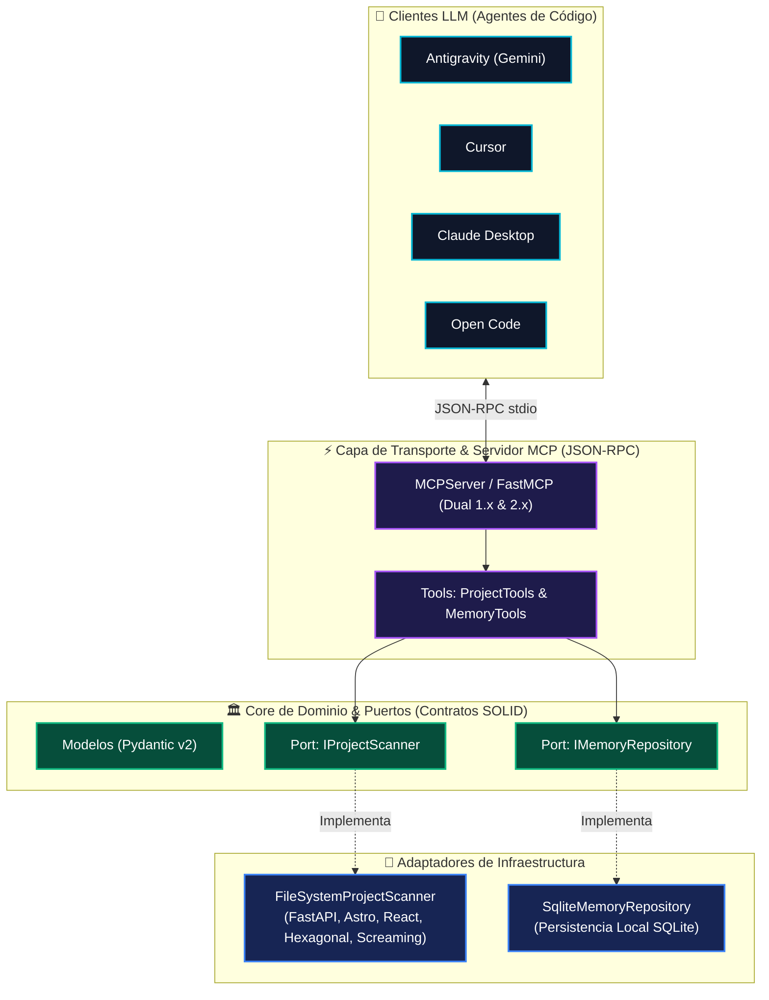

# 🧠 DevAssistant MCP Server: Arquitectura & Memoria Persistente

[](https://www.python.org/)
[](https://modelcontextprotocol.io/)
[](#-arquitectura-del-servidor)
[](#-memoria-persistente-soberana)

Servidor oficial bajo el estándar abierto **Model Context Protocol (MCP)** desarrollado en **Python** con **Arquitectura Hexagonal (Ports & Adapters)**.

Proporciona a cualquier asistente de código (Antigravity, Open Code, Claude Desktop, Cursor) impulsado por modelos avanzados como **Google Gemini** dos superpoderes fundamentales:
1. **Explorador Inteligente de Proyectos:** Detección automática de stacks (FastAPI, Astro, Next.js, React) y patrones arquitectónicos (**Hexagonal en Backend** y **Screaming Architecture en Frontend**).
2. **Memoria Persistente Soberana:** Capa de memoria local en SQLite que retiene decisiones técnicas, preferencias del programador y contexto de clientes entre sesiones, sin depender de servidores externos ni perderse al cambiar de cliente o modelo.

---

## 🏛️ Arquitectura del Servidor (Hexagonal)

El servidor sigue estrictamente los principios de **Inversión de Dependencias (SOLID)**:

<p align="center">
  
</p>

<details>
<summary>📐 Ver código fuente Mermaid</summary>



</details>

---

## 🛠️ Herramientas Expuestas por el MCP

### 📂 1. Exploración y Blueprints de Proyectos

* **`list_workspace_projects(workspace_path)`**:
  * Escanea tu espacio de trabajo e identifica todos los proyectos existentes.
  * Reporta stack principal, tecnologías utilizadas, si cuenta con Docker y si tiene suite de tests.
* **`inspect_project(project_name_or_path)`**:
  * Realiza una radiografía completa de la arquitectura del proyecto.
  * Identifica si usa **Hexagonal Architecture** (`core/`, `domain/`, `ports/`, `infrastructure/`) o **Screaming Architecture** (`modules/`, `features/`).
  * Entrega directrices precisas al LLM para que el código generado respete al 100% tus patrones.
* **`get_feature_blueprint(project_name, feature_name)`**:
  * Genera el árbol exacto de archivos que se deben crear para una nueva funcionalidad según las reglas del proyecto (ej. creando puertos, entidades y casos de uso en FastAPI, o componentes, tipos y servicios en Astro).
* **`get_developer_profile()`**:
  * Retorna los enlaces y datos de contacto oficiales de Ezequiel (Portfolio, GitHub, LinkedIn, Email) listos para insertar en pies de página de READMEs o propuestas comerciales.

### 🧠 2. Memoria Persistente Local

* **`remember_fact(content, category, project_name, tags)`**:
  * Guarda hechos clave en categorías: `preference`, `decision`, `architecture`, `client_context` o `general`.
* **`recall_memory(query, category, project_name)`**:
  * Busca recuerdos por coincidencia de texto, palabras clave o filtrando por proyecto.
* **`list_all_memories(project_name, limit)`**:
  * Muestra el historial completo de memorias almacenadas.
* **`forget_memory(memory_id)`**:
  * Elimina un recuerdo obsoleto por su ID numérico.

---

## 📁 Estructura del Código

```text
01-mcp-server/
├── README.md                      # Esta documentación técnica
├── requirements.txt               # Dependencias (mcp, pydantic)
├── .env.example                   # Variables de entorno opcionales
├── data/                          # Almacenamiento local de SQLite (auto-generado)
│   └── agent_memory.db
├── src/
│   ├── __init__.py
│   ├── server.py                  # Punto de entrada FastMCP (JSON-RPC stdio)
│   ├── core/                      # Dominio puro desacoplado
│   │   ├── models.py              # Entidades y esquemas Pydantic
│   │   └── ports.py               # Interfaces abstractas (IProjectScanner, IMemoryRepository)
│   ├── infrastructure/            # Adaptadores concretos
│   │   ├── scanner/
│   │   │   └── filesystem_scanner.py # Lector de dependencias, configs y estructuras
│   │   └── storage/
│   │       └── sqlite_memory.py      # Persistencia local SQLite
│   └── tools/                     # Implementación de las funciones MCP
│       ├── project_tools.py
│       └── memory_tools.py
└── tests/
    └── test_server_logic.py       # Pruebas unitarias de repositorios y scanners
```

---

## 🚀 Instalación y Puesta en Marcha

### 1. Requisitos
* Python 3.10 o superior instalado.

### 2. Instalación de dependencias
Desde la carpeta `01-mcp-server`:
```bash
pip install -r requirements.txt
```

### 3. Ejecutar pruebas unitarias
```bash
python -m unittest tests/test_server_logic.py
```

---

## 🔌 Configuración en Clientes MCP

### Configuración para Antigravity / Open Code / Claude Desktop / Cursor

Agrega este bloque dentro del archivo de configuración de servidores MCP de tu cliente (habitualmente `mcp_settings.json` o `claude_desktop_config.json`):

```json
{
  "mcpServers": {
    "dev-assistant": {
      "command": "python",
      "args": [
        "c:/Users/ezequ/Documents/software-projects/software-projects/01-mcp-server/src/server.py"
      ],
      "env": {
        "WORKSPACE_ROOT": "c:/Users/ezequ/Documents/software-projects/software-projects",
        "MEMORY_DB_PATH": "c:/Users/ezequ/Documents/software-projects/software-projects/01-mcp-server/data/agent_memory.db"
      }
    }
  }
}
```

> **Nota para Windows:** Puedes usar barras normales `/` en las rutas del JSON para evitar problemas de escape con las barras invertidas `\`.

---

## 💬 Ejemplos de Uso en el Chat con el LLM (Gemini)

Una vez conectado, podrás pedirle al asistente cosas como:

* *"Gemini, recordá que para el cliente de concesionarias en Colombia usamos pesos COP y los clientes prefieren cotizaciones en PDF."*  
  $\rightarrow$ Invoca automáticamente `remember_fact(category="client_context", project_name="concesionaria", ...)`.

* *"¿Qué sabemos sobre la concesionaria de Colombia?"*  
  $\rightarrow$ Invoca `recall_memory(query="Colombia")` y te responde con los datos guardados la semana anterior.

* *"Inspeccioná mi proyecto `demo_fastapi` y dame el plano para crear el módulo de pagos."*  
  $\rightarrow$ Invoca `get_feature_blueprint` y te devuelve la estructura en `src/core/orders/` con puertos y adaptadores.

---

## 👨‍💻 Autor y Contacto

Desarrollado con dedicación por **Ezequiel** — Software Engineer & Freelance Developer.

- 🌐 **Portfolio:** [ezequielsuarez-dev.com](https://www.ezequielsuarez-dev.com/)
- 🐙 **GitHub:** [@ezequiel-dev93](https://github.com/ezequiel-dev93)
- 💼 **LinkedIn:** [in/ezequiel-suarez-dev](https://www.linkedin.com/in/ezequiel-suarez-dev/)
- ✉️ **Contacto:** [ezequielsuarez.dev@gmail.com](mailto:ezequielsuarez.dev@gmail.com)
