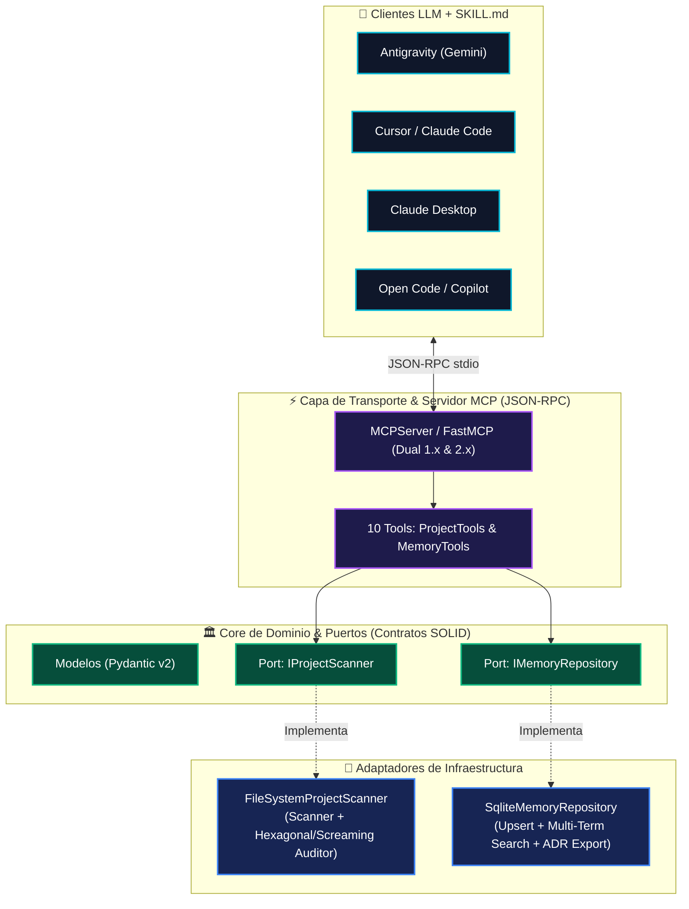

# 🧠 DevAssistant MCP Server: Arquitectura, Auditoría & Memoria Persistente

[](https://www.python.org/)
[](https://modelcontextprotocol.io/)
[](SKILL.md)
[](#-arquitectura-del-servidor)
[](#-memoria-persistente-soberana)
[](LICENSE)

Servidor bajo el estándar **Model Context Protocol (MCP)** + paquete **`SKILL.md`** desarrollado en **Python** con **Arquitectura Hexagonal (Ports & Adapters)**.

Proporciona a cualquier asistente de código (**Antigravity, Claude Code, Cursor, Claude Desktop, Copilot, Open Code**) tres superpoderes fundamentales:
1. **Explorador y Auditor de Arquitecturas (`Linter Hexagonal`):** Detección automática de stacks (FastAPI, Astro, Next.js, React, Streamlit), generación de *Blueprints* y **auditoría de código estático** para detectar violaciones de límites en **Arquitectura Hexagonal** y **Screaming Architecture**.
2. **Memoria Persistente Soberana (SQLite con Upsert y Búsqueda Multi-término):** Retiene decisiones técnicas, preferencias del programador y contexto de clientes entre sesiones con deduplicación inteligente y sin depender de servidores externos.
3. **Generador Automático de ADRs (`Architecture Decision Records`):** Consolida las decisiones y reglas almacenadas en SQLite y exporta documentación `ADR.md` lista para producción.

---

## 🏛️ Arquitectura del Servidor (Hexagonal)

El servidor sigue estrictamente los principios de **Inversión de Dependencias (SOLID)**:

<p align="center">
  
</p>

<details>
<summary>📐 Ver código fuente Mermaid</summary>



</details>

---

## 🛠️ Las 10 Herramientas Expuestas por el MCP

### 📂 1. Exploración, Auditoría y Blueprints de Proyectos

* **`list_workspace_projects(workspace_path)`**:
  * Escanea tu espacio de trabajo e identifica todos los proyectos existentes, su stack principal, tecnologías, Docker y suite de tests.
* **`inspect_project(project_name_or_path)`**:
  * Realiza una radiografía completa de la arquitectura del proyecto (**Hexagonal Architecture** o **Screaming Architecture**) y entrega directrices precisas al LLM.
* **`audit_architecture(project_name_or_path)`** *(Nuevo)*:
  * Escanea los imports reales de los archivos de código (`.py`, `.ts`, `.tsx`, `.astro`) y detecta si algún archivo de `core/domain/ports` importa librerías prohibidas de infraestructura (`fastapi`, `sqlalchemy`, `sqlite3`, `httpx`, `adapters`) o si un componente UI accede directo a la base de datos.
* **`get_feature_blueprint(project_name, feature_name)`**:
  * Genera el árbol exacto de archivos que se deben crear para una nueva funcionalidad según las reglas del proyecto.
* **`get_developer_profile()`**:
  * Retorna los enlaces y datos de contacto oficiales de Ezequiel (Portfolio, GitHub, LinkedIn, Email).

### 🧠 2. Memoria Persistente Local & Exportación ADR

* **`remember_fact(content, category, project_name, tags)`**:
  * Guarda o actualiza automáticamente (**Upsert sin duplicados**, fusionando tags) hechos clave en categorías: `preference`, `decision`, `architecture`, `client_context` o `general`.
* **`recall_memory(query, category, project_name)`**:
  * Búsqueda inteligente **multi-término** (por palabras clave independientes, tags, categoría o proyecto) con ranking de coincidencia.
* **`list_all_memories(project_name, limit)`**:
  * Muestra el historial completo de memorias almacenadas.
* **`forget_memory(memory_id)`**:
  * Elimina un recuerdo obsoleto por su ID numérico.
* **`export_project_adr(project_name, output_path)`** *(Nuevo)*:
  * Consolida todas las decisiones técnicas y reglas arquitectónicas guardadas en SQLite y genera automáticamente un documento Markdown de **Architecture Decision Records (`ADR.md`)**.

---

## 📁 Estructura del Código

```text
01-mcp-server/
├── README.md                      # Documentación técnica completa
├── SKILL.md                       # Skill autónoma para Agentes (Claude Code, Cursor, Antigravity)
├── LICENSE                        # Licencia Propietaria (All Rights Reserved)
├── pyproject.toml                 # Empaquetado estándar PEP 621 y CLI script (dev-assistant-mcp)
├── requirements.txt               # Dependencias (mcp, pydantic)
├── .env.example                   # Variables de entorno opcionales
├── data/                          # Almacenamiento local de SQLite (auto-generado)
│   └── agent_memory.db
├── src/
│   ├── __init__.py
│   ├── server.py                  # Punto de entrada FastMCP (10 herramientas JSON-RPC stdio)
│   ├── core/                      # Dominio puro desacoplado
│   │   ├── models.py              # Entidades y esquemas Pydantic v2 (incluye ArchitectureAuditReport)
│   │   └── ports.py               # Interfaces abstractas (IProjectScanner, IMemoryRepository)
│   ├── infrastructure/            # Adaptadores concretos
│   │   ├── scanner/
│   │   │   └── filesystem_scanner.py # Scanner + Auditor estático de imports Hexagonal/Screaming
│   │   └── storage/
│   │       └── sqlite_memory.py      # Persistencia SQLite con Upsert y búsqueda multi-término
│   └── tools/                     # Implementación de las funciones MCP
│       ├── project_tools.py
│       └── memory_tools.py
└── tests/
    └── test_server_logic.py       # Suite de pruebas unitarias (Scanner, Auditor, Upsert, ADR)
```

---

## 🚀 Instalación y Puesta en Marcha

### 1. Instalación rápida (vía `pyproject.toml` o `requirements.txt`)
Desde la carpeta `01-mcp-server`:
```bash
pip install -e .
# o alternativamente:
pip install -r requirements.txt
```

### 2. Ejecutar pruebas unitarias
```bash
python -m unittest tests/test_server_logic.py
```

---

## 🔌 Configuración en Clientes MCP + Instalación de `SKILL.md`

### 1. Conectar el Servidor MCP (`mcp_settings.json` / `claude_desktop_config.json`)

```json
{
  "mcpServers": {
    "dev-assistant": {
      "command": "python",
      "args": [
        "c:/Users/ezequ/Documents/software-projects/software-projects/01-mcp-server/src/server.py"
      ],
      "env": {
        "WORKSPACE_ROOT": "c:/Users/ezequ/Documents/software-projects/software-projects",
        "MEMORY_DB_PATH": "c:/Users/ezequ/Documents/software-projects/software-projects/01-mcp-server/data/agent_memory.db"
      }
    }
  }
}
```

### 2. Activar la Skill Autónoma (`SKILL.md`)
Copia el archivo [`SKILL.md`](SKILL.md) dentro del directorio de skills de tu agente (por ejemplo `.claude/skills/dev-assistant/SKILL.md`, `.cursor/skills/` o `.gemini/skills/`) para que el asistente ejecute automáticamente el protocolo de 5 pasos (Recall $\rightarrow$ Blueprint $\rightarrow$ Audit $\rightarrow$ Remember $\rightarrow$ ADR).

---

## 👨‍💻 Autor y Contacto

Desarrollado con dedicación por **Ezequiel Suárez** — Software Engineer & Freelance Developer.

- 🌐 **Portfolio:** [ezequielsuarez-dev.com](https://www.ezequielsuarez-dev.com/)
- 🐙 **GitHub:** [@ezequiel-dev93](https://github.com/ezequiel-dev93)
- 💼 **LinkedIn:** [in/ezequiel-suarez-dev](https://www.linkedin.com/in/ezequiel-suarez-dev/)
- ✉️ **Contacto:** [ezequielsuarez.dev@gmail.com](mailto:ezequielsuarez.dev@gmail.com)
